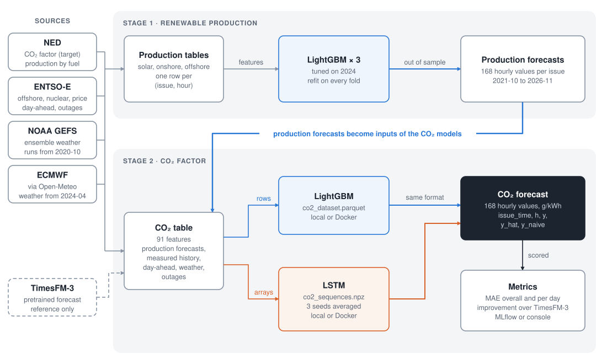
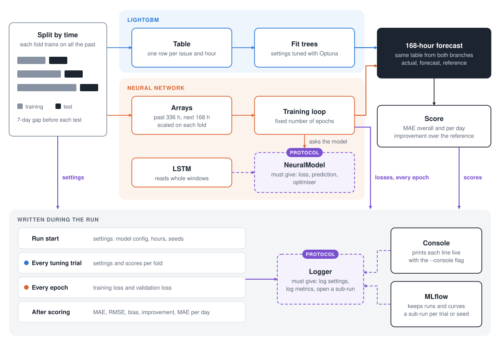
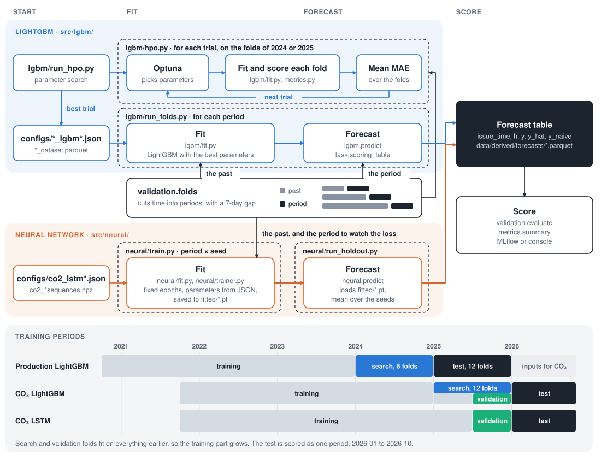

# CO₂ factor forecast for electricity in the Netherlands

Forecasts the CO₂ factor for the next 168 hours at 1-hour resolution. LightGBM models first forecast renewable production; the CO₂ models then use those forecasts as inputs.



A forecast is issued daily at 06:00 UTC for hours `h = 0…167`. Inputs must be known at issue, and tables are indexed by `(issue_time, h)`.

## Run

The feature tables and model configs are committed, so the models run without raw data. `make` lists all targets.

```bash
uv sync --extra neural   # dependencies with torch (uv sync: without torch)
make mlflow              # MLflow in Docker at http://localhost:5001; without it, runs go to mlruns/
make train               # all models on the validation periods, DEVICE=cuda for a GPU
make train-test          # CO₂ models on the 2026 test folds
make train-final         # models of the last test fold, overwrites fitted/
```

`make hpo co2-hpo` repeats the parameter search and overwrites the configs. `make renewables co2` rebuilds the tables as well and needs the raw data (see [Data](#data)).

### Docker

I trained the LSTM and tuned the days 3–7 LightGBM on Kaggle, with its GPU and package versions (torch 2.11, LightGBM 4.6, pandas 2.3). The image uses the versions in `uv.lock` (torch 2.15, LightGBM 4.7, pandas 3.1), so training in Docker may not match my results exactly. To train in Docker:

```bash
make mlflow
make image                    # LightGBM image, and the LSTM image with torch
make train DOCKER=1
make train-test DOCKER=1
```

Rebuild the images after changing `src/`. Exit code 137 means the container ran out of memory; raise the limit in Docker Desktop.

## Models



Each branch has two CO₂ models. Days 1–2 predict the change from the last hour before issue; days 3–7 predict the deviation from the 28-day hourly profile. `Trainer` works with any model that follows the [`NeuralModel`](src/neural/models.py) protocol, and runs log through the [`Logger`](src/loggers.py) protocol.

Inputs, parameters, metrics and commands for each model are in its card: [CO₂ LSTM](docs/models/co2_lstm.md), [CO₂ LightGBM](docs/models/co2_lgbm.md), [solar](docs/models/solar.md), [onshore wind](docs/models/onshore.md), [offshore wind](docs/models/offshore.md).

### Training pipeline

LightGBM and the neural network follow the same scheme, and training starts from the files named on the frames.



### Fit from a config

Each file in `configs/` holds the parameters of one model. `run_holdout` reads the file, fits the model on the data before the test period and saves the forecasts; `--save` also keeps the fitted model. This command gives MAE 24.92 g/kWh on the second half of 2025:

```bash
PYTHONPATH=src uv run python -m lgbm.run_holdout co2 --hours 0 48 \
    --start 2025-07-01 --end 2026-01-01 --splits 1 --save fitted --console
```

The LightGBM tasks are `solar`, `onshore`, `offshore`, `co2` (hours 0–48) and `co2_far` (hours 48–168). The LSTM and MLP split the two steps: `neural.train` fits the networks of a config and saves them, and `neural.run_holdout` loads the saved networks and forecasts, without training:

```bash
PYTHONPATH=src uv run --extra neural python -m neural.train configs/co2_lstm_h0-48.json --hours 0 48 \
    --start 2025-07-01 --end 2026-01-01 --seeds 3 --save data/derived/lstm_validation --console
PYTHONPATH=src uv run --extra neural python -m neural.run_holdout data/derived/lstm_validation/co2_lstm_h0-48 \
    --start 2025-07-01 --end 2026-01-01 --console
```

## Trained models

`fitted/` holds the models of the last test fold: trained on issues up to 2026-08-20, they forecast 2026-08-28 – 2026-10-26 with the numbers in the report. File names follow the configs, and the LSTM has one file per seed.

The LSTM files load with `neural.load` and forecast with `neural.predict` ([fit.py](src/neural/fit.py)). The LightGBM files open with `lightgbm.Booster(model_file=...)`; add `co2_last` to the output for days 1–2 and `co2_prof` for days 3–7 to get g CO₂/kWh. On macOS, run the LSTM and LightGBM in separate processes, because together they crash.

## Data

The repository holds only the feature tables, 240 MB in `data/derived/`: `solar_dataset.parquet`, `onshore_dataset.parquet`, `offshore_dataset.parquet` and `co2_dataset.parquet`, plus `co2_sequences.npz` and `co2_far_sequences.npz` for the LSTM.

The raw data from NED, ENTSO-E, NOAA GEFS and ECMWF is 10 GB, so I do not commit it to git; I can send it on request. To rebuild the tables, put it in `data/raw/` and run `make renewables co2`.

## Validation

Folds use an expanding window with a 7-day gap before each block.

| Period | Production models | CO₂ models |
|---|---|---|
| until 2023-12 | training | training |
| 2024 | tuning, 6 folds | training |
| 2025 | test, 12 folds | LightGBM tuning on 12 folds, model comparison on 2025-07 – 2025-12 |
| 2026 | not used | final test, once |

## Known gaps

- The CO₂ table cannot be rebuilt from a clean clone: it reads the TimesFM-3 reference from `data/derived/references/`, which is not in the repository, and the scripts that computed it were removed. The committed table already holds it as `y_ref`.
- Production forecasts for 2021–2023 use parameters tuned on 2024; they enter only the CO₂ training data.
