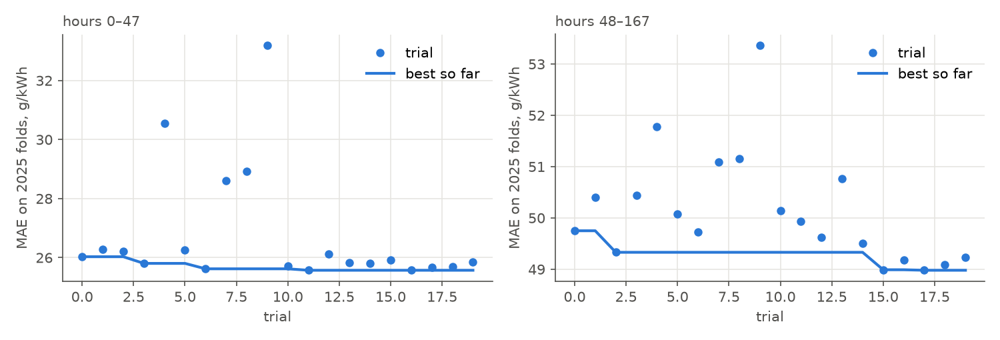
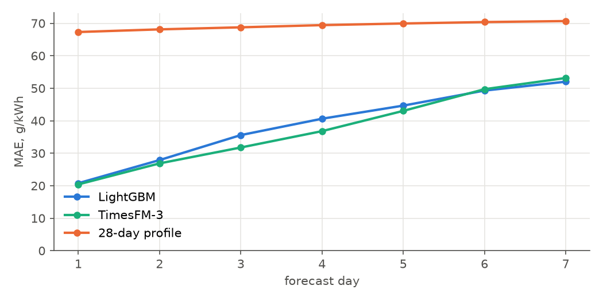
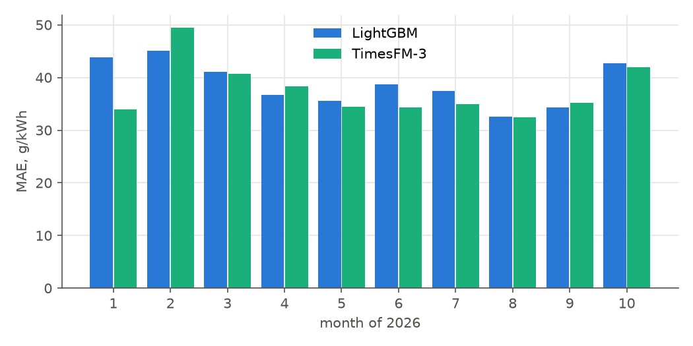
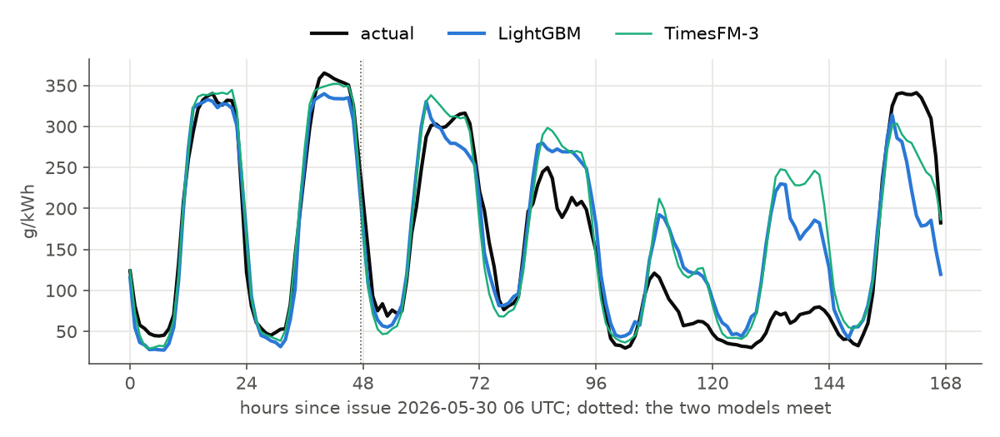
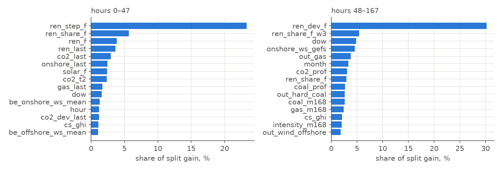

# CO₂ factor, Netherlands: LightGBM models

Two models forecast the hourly CO₂ factor for the 168 hours after each 06 UTC issue: one for
hours 0–47, one for hours 48–167. Metrics are in g CO₂/kWh unless stated.

## Task

|  |  |
|---|---|
| target series | NED ElectricityMix `emissionfactor`, g CO₂/kWh |
| issue time | 06 UTC daily; window hours 0–167 from issue |
| hours 0–47, target | CO₂ at the hour minus CO₂ in the hour before issue |
| hours 48–167, target | CO₂ at the hour minus its 28-day profile at that hour |
| back to CO₂ | the base above + model output, clipped at 0 |
| reference | TimesFM-3, zero-shot, context 8192 h: measured series as past covariates; calendar, the renewables forecasts, weather and outages as known covariates |
| naive | mean of the same hour over the 28 days before issue |
| model | LightGBM regressor, L1 objective, one model per horizon with h as a feature |

## Periods

| period | use |
|---|---|
| 2021-10 – 2024-12 | training |
| 2025-01 – 2025-12 | LightGBM: search over 12 monthly expanding folds, 7-day gap |
| 2025-07 – 2025-12 | validation: one training up to 2025-06-23, 184 daily forecasts |
| 2026-01 – 2026-10 | test: 299 daily forecasts, 5 two-month folds, refit before each |

## Features

Hours 0–47 use 91 features, hours 48–167 use 54; the day-ahead
values (8 features) are empty past h ≈ 16. Lists: `src/tasks/co2.py`. Missing values stay NaN.

| group | features | hours |
|---|---|---|
| renewables forecast | LightGBM predictors, out of sample: solar, onshore, offshore, sum, share of the 28-day production level, deviation from profile; in hours 0–47 also the step from the last hour | both |
| smoothed renewables forecast | sum and share: means over ±3 h, ±12 h, the local day | 48–167 |
| weather | GEFS and ECMWF wind and clearness with spread, temperature, GEFS wind over Germany and Belgium | both |
| CO₂ level | 168 h mean, 28-day profile at the target hour, CO₂ per kWh of non-renewable output, its product with (1 − forecast share) | both |
| generation regime | gas and coal: 168 h mean, profile; total production and load: profile | both |
| announced outages | unavailable MW at the target hour by fuel, latest version published before issue | both |
| calendar | h, hour, weekday, month | both |
| state at issue | CO₂ at T−1, T−2, T−3 and the same hour, deviations from profile, 24 h means of all series, measured renewables | 0–47 |
| day-ahead | ENTSO-E load, generation, renewables, price for hours of the issue's local day (h ≈ 0–16) | 0–47 |

## Hyperparameter search

Optuna TPE, 20 trials, objective: MAE averaged over 12 monthly folds of 2025. Trials of hours
0–47 are in MLflow (experiment `hpo`, run `co2_lgbm_h0-48`); the trials of hours 48–167 were logged to the console of that run.

| parameter | range | scale |
|---|---|---|
| n_estimators | 100 – 500, step 100 | linear |
| learning_rate | 0.01 – 0.1 | log |
| num_leaves | 15 – 127 | log |
| min_child_samples | 20 – 300 | log |
| colsample_bytree | 0.5 – 1.0 | linear |
| reg_lambda | 0.001 – 10 | log |

Fixed: objective = l1 (MAE), subsample = 0.8 every iteration, seed = 0.



### Best configurations

| parameter | hours 0–47 | hours 48–167 |
|---|---|---|
| seed | 0 | 0 |
| objective | l1 | l1 |
| n_estimators | 500 | 500 |
| learning_rate | 0.05024 | 0.08176 |
| num_leaves | 107 | 16 |
| min_child_samples | 185 | 48 |
| subsample | 0.8 | 0.8 |
| colsample_bytree | 0.5176 | 0.7468 |
| reg_lambda | 0.009192 | 0.03988 |

Both searches ended on the upper limit of 500 trees. Mean over the 2025 folds, trials 11 and 17:

| metric | hours 0–47 | hours 48–167 |
|---|---|---|
| MAE | 25.6 | 49.0 |
| RMSE | 34.0 | 65.0 |
| bias (forecast − actual) | 1.3 | 1.0 |
| Spearman within window | 0.920 | 0.806 |

## Validation, second half of 2025

The hyperparameters were chosen on 2025, which includes this half-year, so these numbers are
slightly optimistic.

| metric | LightGBM | TimesFM-3 | 28-day profile |
|---|---|---|---|
| MAE, week | 42.2 | 42.7 | 82.9 |
| MAE, hours 0–47 | 24.9 | 24.1 | 81.1 |
| MAE, hours 48–167 | 49.1 | 50.2 | 83.6 |
| RMSE | 58.2 | 61.4 | 101.9 |
| bias (forecast − actual) | -4.0 | 16.7 | -5.0 |
| improvement over TimesFM-3, % | 1.2 | — | — |
| Spearman within window | 0.829 | 0.834 | 0.517 |
| MAE day 1 | 21.1 | 21.0 | 80.1 |
| MAE day 2 | 28.8 | 27.1 | 82.0 |
| MAE day 3 | 35.4 | 32.5 | 83.1 |
| MAE day 4 | 40.9 | 39.6 | 83.3 |
| MAE day 5 | 48.1 | 49.9 | 83.8 |
| MAE day 6 | 58.8 | 61.7 | 84.0 |
| MAE day 7 | 62.3 | 67.1 | 83.6 |

## Test 2026

Forecast once with these configurations; no decisions were made on this period.

| metric | LightGBM | TimesFM-3 | 28-day profile |
|---|---|---|---|
| MAE, week | 38.7 | 37.4 | 69.2 |
| MAE, hours 0–47 | 24.3 | 23.6 | 67.7 |
| MAE, hours 48–167 | 44.4 | 42.9 | 69.8 |
| RMSE | 53.6 | 52.9 | 88.5 |
| bias (forecast − actual) | -5.7 | 6.1 | -0.9 |
| improvement over TimesFM-3, % | -3.5 | — | — |
| Spearman within window | 0.867 | 0.868 | 0.639 |
| MAE day 1 | 20.8 | 20.4 | 67.3 |
| MAE day 2 | 27.9 | 26.9 | 68.1 |
| MAE day 3 | 35.6 | 31.8 | 68.8 |
| MAE day 4 | 40.6 | 36.8 | 69.4 |
| MAE day 5 | 44.7 | 43.0 | 69.9 |
| MAE day 6 | 49.3 | 49.7 | 70.4 |
| MAE day 7 | 52.0 | 53.2 | 70.7 |







## Feature importance

Top 15 by share of split gain, models fit on all issues before 2025-12-25.



## Reproduce

```
make co2
PYTHONPATH=src uv run python -m lgbm.run_folds co2 --hours 0 48 --start 2026-01-01 --end 2026-10-27 --splits 5
PYTHONPATH=src uv run python -m lgbm.run_folds co2_far --hours 48 168 --start 2026-01-01 --end 2026-10-27 --splits 5
```
