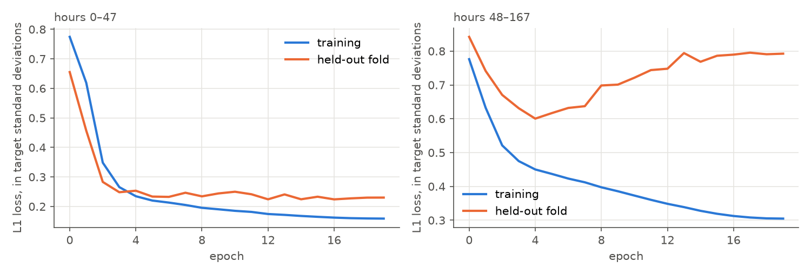
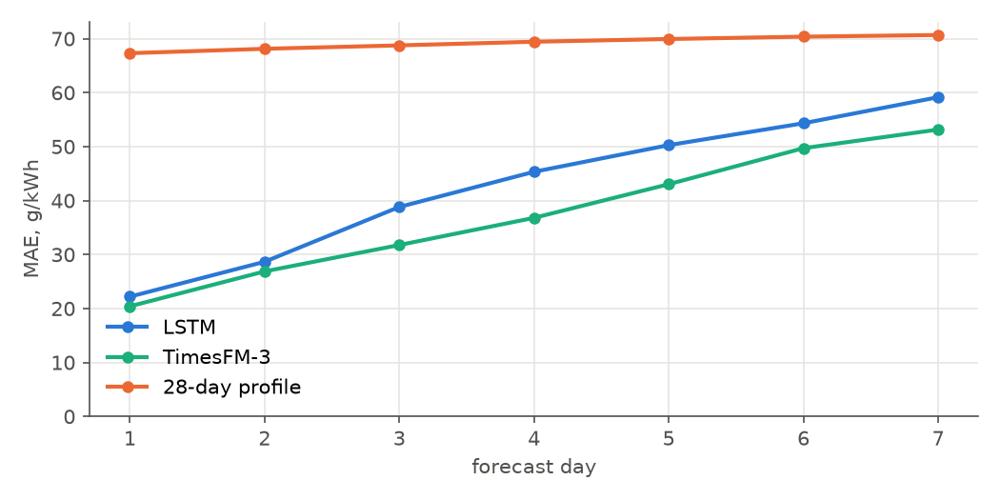
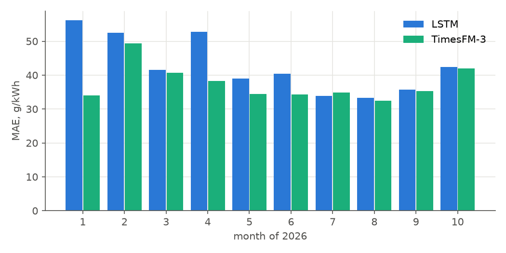
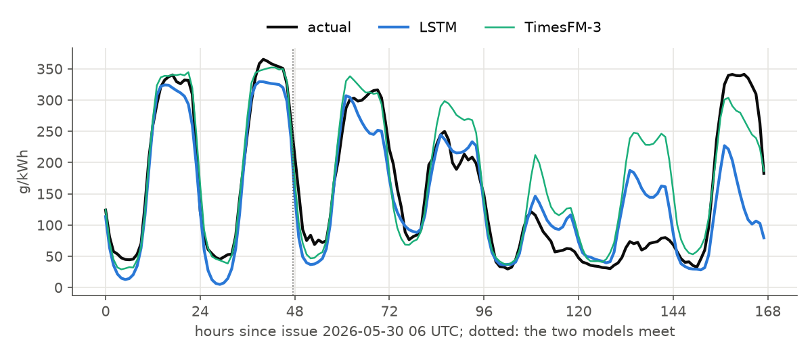

# CO₂ factor, Netherlands: LSTM models

Two networks forecast the hourly CO₂ factor for the 168 hours after each 06 UTC issue: one
trained on hours 0–47, one on hours 48–167. Metrics are in g CO₂/kWh unless stated.

## Task

|  |  |
|---|---|
| target series | NED ElectricityMix `emissionfactor`, g CO₂/kWh |
| issue time | 06 UTC daily; window hours 0–167 from issue |
| hours 0–47, target | CO₂ at the hour minus CO₂ in the hour before issue |
| hours 48–167, target | CO₂ at the hour minus its 28-day profile at that hour |
| back to CO₂ | the base above + model output, clipped at 0 |
| reference | TimesFM-3, zero-shot, context 8192 h: measured series as past covariates; calendar, the renewables forecasts, weather and outages as known covariates |
| naive | mean of the same hour over the 28 days before issue |

## Periods

| period | use |
|---|---|
| 2021-10 – 2024-12 | training |
| 2025-07 – 2025-12 | validation: one training up to 2025-06-23, 184 daily forecasts |
| 2026-01 – 2026-10 | test: 299 daily forecasts, 5 two-month folds, refit before each |

## Inputs

Past channels: every measured series (CO₂, renewables, gas, coal, CHP, waste, biomass, nuclear,
other, total production, load, price, CO₂ per kWh of non-renewable output) and the calendar.
Future channels: the feature groups below for the horizon, with the calendar. Unlike the LightGBM
model for hours 48–167, this network keeps the history through its encoder.

Channel counts include flags for gaps.

| model | past channels | future channels |
|---|---|---|
| hours 0–47 | 26 | 75 |
| hours 48–167 | 26 | 66 |

| group | features | hours |
|---|---|---|
| renewables forecast | LightGBM predictors, out of sample: solar, onshore, offshore, sum, share of the 28-day production level, deviation from profile; in hours 0–47 also the step from the last hour | both |
| smoothed renewables forecast | sum and share: means over ±3 h, ±12 h, the local day | 48–167 |
| weather | GEFS and ECMWF wind and clearness with spread, temperature, GEFS wind over Germany and Belgium | both |
| CO₂ level | 168 h mean, 28-day profile at the target hour, CO₂ per kWh of non-renewable output, its product with (1 − forecast share) | both |
| generation regime | gas and coal: 168 h mean, profile; total production and load: profile | both |
| announced outages | unavailable MW at the target hour by fuel, latest version published before issue | both |
| calendar | h, hour, weekday, month | both |
| day-ahead | ENTSO-E load, generation, renewables, price for hours of the issue's local day (h ≈ 0–16) | 0–47 |

## Model

| part | description |
|---|---|
| encoder | LSTM over the 336 hours before issue, 2 layers, 64 units |
| decoder | bidirectional LSTM over the 168 forecast hours, 2 layers, 64 units; the encoder's last state joins every hour |
| head | dropout 0.2, linear layer, one value per hour |
| loss | L1 over the hours of the horizon; all 168 hours enter the decoder |

## Training

There was no hyperparameter search; these are starting values.

|  |  |
|---|---|
| optimiser | AdamW, lr 0.001, weight decay 0.01, one-cycle schedule |
| epochs, batch | 20, 32; no early stopping |
| gradient clip | 1.0 |
| scaling | inputs and target standardised on the training issues of each fold; gaps become 0 with a flag channel |
| seeds | forecast = mean over seeds: validation 5 (hours 0–47) and 3 (hours 48–167), test 3 |
| hardware | Kaggle, Tesla T4 |

Mean over the seeds of the first 2026 fold (training up to 2025-12-24).



## Validation, second half of 2025

| metric | LSTM | TimesFM-3 | 28-day profile |
|---|---|---|---|
| MAE, week | 41.5 | 42.7 | 82.9 |
| MAE, hours 0–47 | 22.6 | 24.1 | 81.1 |
| MAE, hours 48–167 | 49.1 | 50.2 | 83.6 |
| RMSE | 58.2 | 61.4 | 101.9 |
| bias (forecast − actual) | -7.2 | 16.7 | -5.0 |
| improvement over TimesFM-3, % | 2.8 | — | — |
| Spearman within window | 0.830 | 0.834 | 0.517 |
| MAE day 1 | 19.6 | 21.0 | 80.1 |
| MAE day 2 | 25.6 | 27.1 | 82.0 |
| MAE day 3 | 35.1 | 32.5 | 83.1 |
| MAE day 4 | 40.1 | 39.6 | 83.3 |
| MAE day 5 | 47.6 | 49.9 | 83.8 |
| MAE day 6 | 59.8 | 61.7 | 84.0 |
| MAE day 7 | 62.9 | 67.1 | 83.6 |

## Test 2026

Forecast once with these configurations; no decisions were made on this period.

| metric | LSTM | TimesFM-3 | 28-day profile |
|---|---|---|---|
| MAE, week | 42.7 | 37.4 | 69.2 |
| MAE, hours 0–47 | 25.4 | 23.6 | 67.7 |
| MAE, hours 48–167 | 49.6 | 42.9 | 69.8 |
| RMSE | 59.6 | 52.9 | 88.5 |
| bias (forecast − actual) | -8.4 | 6.1 | -0.9 |
| improvement over TimesFM-3, % | -14.1 | — | — |
| Spearman within window | 0.852 | 0.868 | 0.639 |
| MAE day 1 | 22.2 | 20.4 | 67.3 |
| MAE day 2 | 28.7 | 26.9 | 68.1 |
| MAE day 3 | 38.8 | 31.8 | 68.8 |
| MAE day 4 | 45.3 | 36.8 | 69.4 |
| MAE day 5 | 50.3 | 43.0 | 69.9 |
| MAE day 6 | 54.3 | 49.7 | 70.4 |
| MAE day 7 | 59.2 | 53.2 | 70.7 |







## Reproduce

```
make co2-lstm DEVICE=cuda
PYTHONPATH=src python -m neural.run configs/co2_lstm_h0-48.json --hours 0 48 --start 2026-01-01 --end 2026-10-27 --splits 5 --seeds 3 --data data/derived/co2_sequences.npz --device cuda
PYTHONPATH=src python -m neural.run configs/co2_lstm_h48-168.json --hours 48 168 --start 2026-01-01 --end 2026-10-27 --splits 5 --seeds 3 --data data/derived/co2_far_sequences.npz --device cuda
PYTHONPATH=src uv run python -m model_card_co2
```
