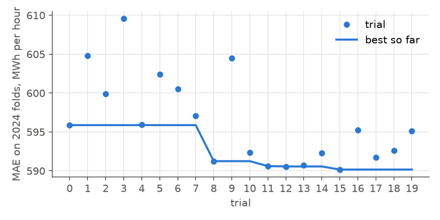
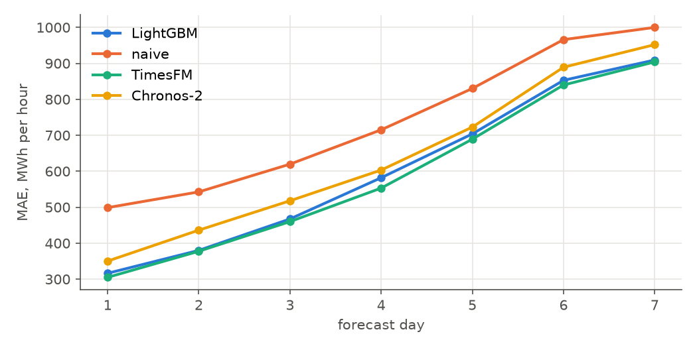
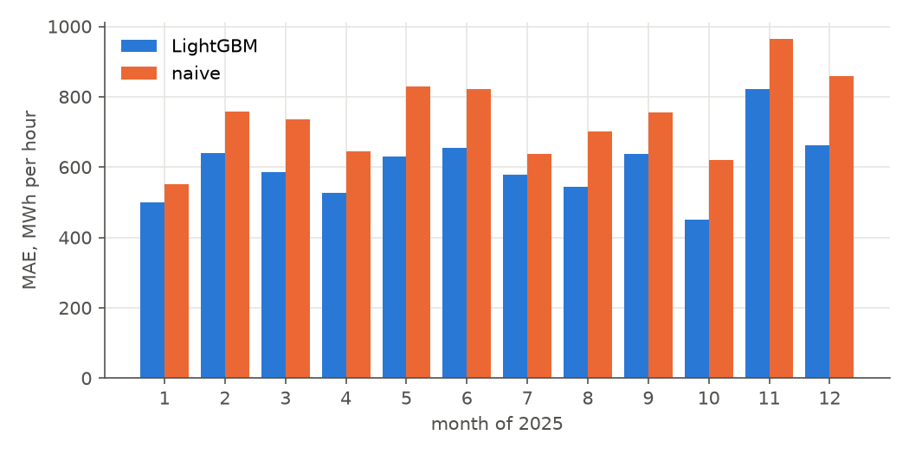
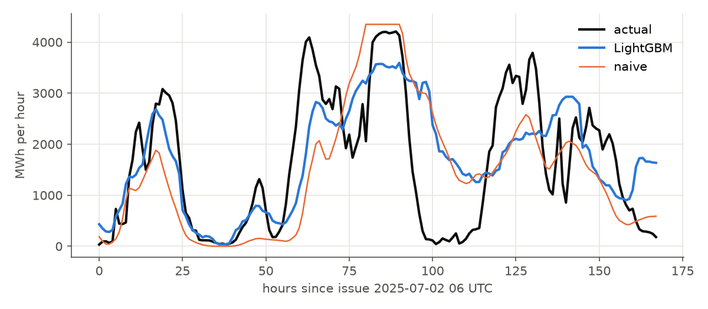
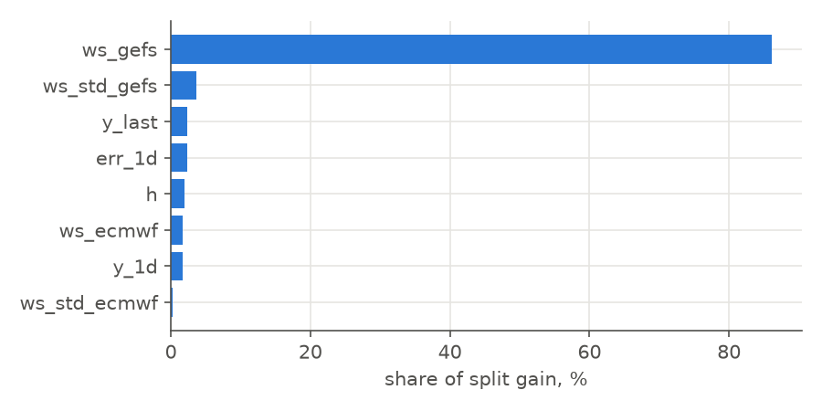

# Offshore wind production, Netherlands: LightGBM predictor

Forecasts hourly production for the 168 hours after each 06 UTC issue from weather forecasts
and the production history available at issue. Metrics are in MWh per hour unless stated.

## Task

| | |
|---|---|
| production series | ENTSO-E actual generation, wind offshore, 15-min MW averaged to hourly kWh |
| target | y = production / cap, where cap is the 99th percentile of hourly production over the 60 days before issue (capacity proxy). |
| back to production | production = y × cap |
| naive reference | cubic power curve of the GEFS wind speed (cut-in 3 m/s, rated 12 m/s) × cap, no model |
| issue time | 06 UTC daily; window hours 0–167 from issue |
| model | LightGBM regressor, L1 objective, one model for all 168 hours |

## Periods

| period | renewables predictors | CO₂ models |
|---|---|---|
| 2020-10 – 2023-12 | training | training |
| 2024-01 – 2024-12 | training | 6 two-month expanding folds, 7-day gap |
| 2025-01 – 2025-12 | 12 monthly expanding folds, scored once | no decisions |

## Features

| feature | description | source | unit |
|---|---|---|---|
| ws_gefs | 100 m wind speed, ensemble mean over the park points | GEFS ensemble (31 members, 00 UTC run), 3-hourly, interpolated to hour centres | m/s |
| ws_std_gefs | ensemble standard deviation of the same speed | GEFS ensemble (31 members, 00 UTC run), 3-hourly, interpolated to hour centres | m/s |
| ws_ecmwf | 100 m wind speed at hour centre, mean over the park points | ECMWF IFS via Open-Meteo previous runs, hourly, lead ceil(h/24) days; from 2024-03 | m/s |
| ws_std_ecmwf | standard deviation of that speed over the park points | ECMWF IFS via Open-Meteo previous runs, hourly, lead ceil(h/24) days; from 2024-03 | m/s |
| h | hour within the 168-hour window (0 = issue, 06 UTC) | calendar | h |
| y_last | production of the hour before issue / cap | production history | fraction |
| y_1d | mean production of the 24 hours before issue / cap | production history | fraction |
| err_1d | mean of (y − power curve of GEFS speed) over the previous issue's hours 0–23 | production history, GEFS | fraction |

Missing values (ECMWF before 2024-03, night hours) stay NaN; LightGBM routes them.

## Hyperparameter search

Optuna TPE, 20 trials, objective: MAE averaged over the six 2024 folds. Each
trial refits the model on every fold and logs all metrics to MLflow (experiment `hpo`,
run `offshore_lgbm`, one child run per trial).

| parameter | range | scale |
|---|---|---|
| n_estimators | 100 – 500, step 100 | linear |
| learning_rate | 0.01 – 0.1 | log |
| num_leaves | 15 – 127 | log |
| min_child_samples | 20 – 300 | log |
| colsample_bytree | 0.5 – 1.0 | linear |
| reg_lambda | 0.001 – 10 | log |

Fixed: objective = l1 (MAE), subsample = 0.8 every iteration, seed = 0.



### Best configuration (trial 15)

| parameter | value |
|---|---|
| seed | 0 |
| objective | l1 |
| n_estimators | 200 |
| learning_rate | 0.05791 |
| num_leaves | 31 |
| min_child_samples | 24 |
| subsample | 0.8 |
| colsample_bytree | 0.8577 |
| reg_lambda | 0.001034 |

Validation metrics of this trial, mean over the 2024 folds:

| metric | value |
|---|---|
| MAE | 590 |
| RMSE | 835 |
| bias (forecast − actual) | -50 |
| improvement over naive, % | 18.0 |
| Spearman within window | 0.662 |
| MAE day 1 | 315 |
| MAE day 2 | 371 |
| MAE day 3 | 466 |
| MAE day 4 | 595 |
| MAE day 5 | 705 |
| MAE day 6 | 796 |
| MAE day 7 | 883 |

## Test 2025

Twelve monthly expanding folds; each month is forecast by a model fit on everything before
it minus a 7-day gap. All 365 issues of 2025 are scored once. TimesFM and Chronos-2 are
zero-shot on the same origins with 1024 hours of production history and the same weather
forecasts as covariates.

| metric | LightGBM | naive | TimesFM | Chronos-2 |
|---|---|---|---|---|
| MAE | 602 | 739 | 590 | 639 |
| RMSE | 854 | 1,057 | 857 | 892 |
| bias (forecast − actual) | -63 | -194 | -82 | -137 |
| improvement over naive, % | 18.6 | 0.0 | 20.2 | 13.6 |
| Spearman within window | 0.687 | 0.653 | 0.693 | 0.676 |
| MAE day 1 | 316 | 499 | 305 | 350 |
| MAE day 2 | 380 | 543 | 377 | 436 |
| MAE day 3 | 467 | 620 | 460 | 518 |
| MAE day 4 | 582 | 715 | 553 | 603 |
| MAE day 5 | 704 | 830 | 689 | 723 |
| MAE day 6 | 853 | 966 | 840 | 889 |
| MAE day 7 | 909 | 1,000 | 904 | 952 |







## Feature importance

Share of total split gain, model fit on all issues before 2025.



## Reproduce

```
PYTHONPATH=src uv run python -m data.features.wind offshore
PYTHONPATH=src uv run python -m lgbm.run_hpo offshore
PYTHONPATH=src uv run python -m lgbm.run_folds offshore
```
