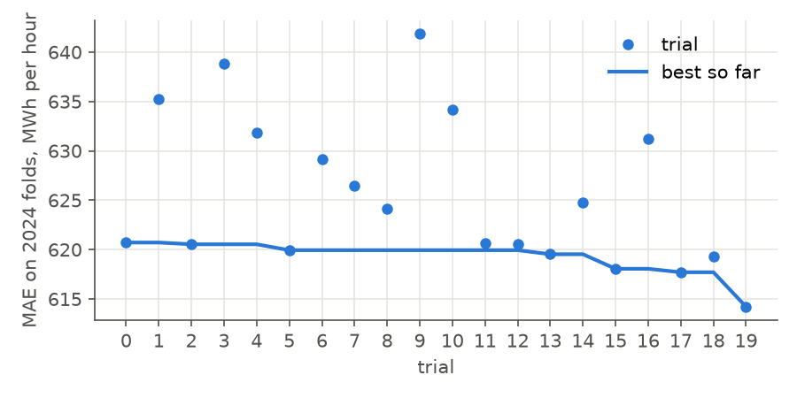
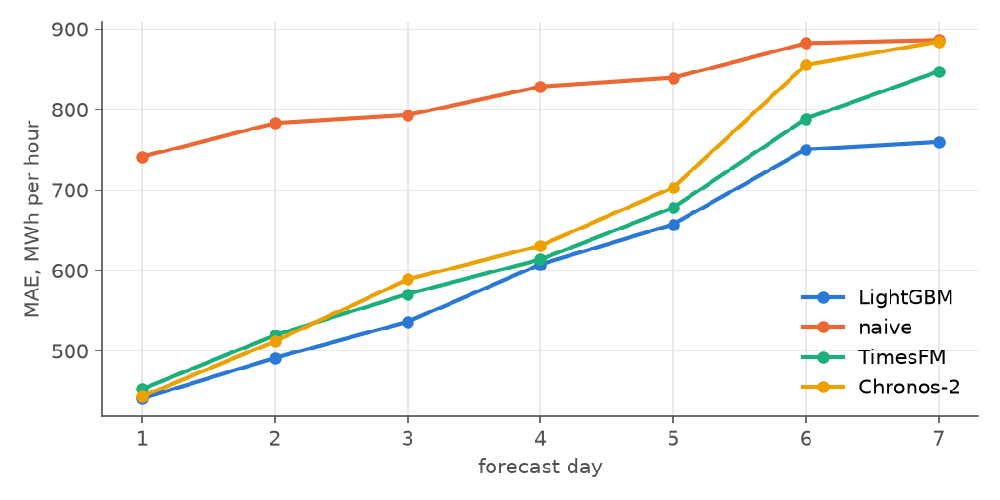
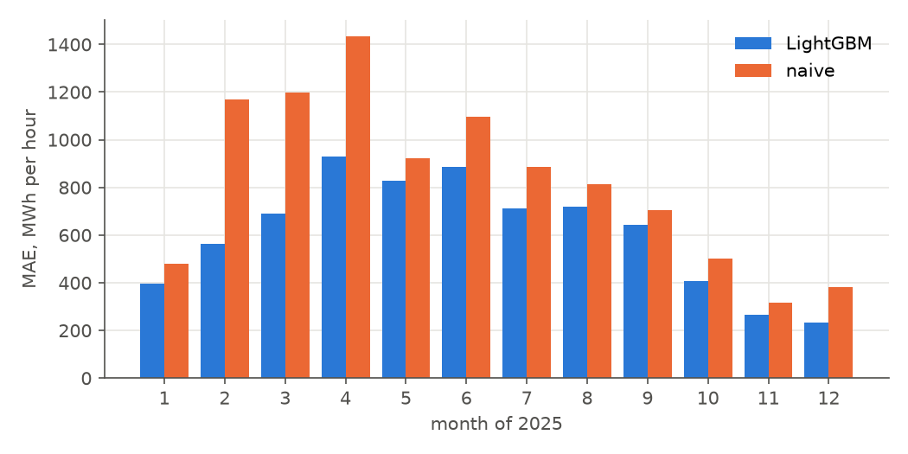
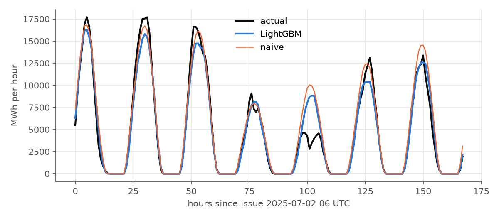
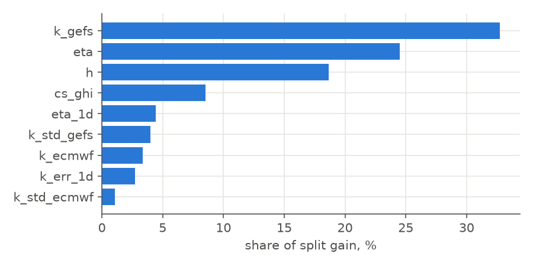

# Solar production, Netherlands: LightGBM predictor

Forecasts hourly production for the 168 hours after each 06 UTC issue from weather forecasts
and the production history available at issue. Metrics are in MWh per hour unless stated.

## Task

| | |
|---|---|
| production series | NED solar, measured (classification 2), hourly kWh |
| target | y = production / cs_ghi, kWh per W/m² of clear-sky irradiance (Haurwitz model, hourly mean at 52.2 N 5.3 E). Night rows (clear sky < 20 W/m²) are not trained on and are forecast as 0. |
| back to production | production = y × cs_ghi |
| naive reference | k_gefs × eta × cs_ghi: the GEFS clearness index applied to the recent capacity, no model |
| issue time | 06 UTC daily; window hours 0–167 from issue |
| model | LightGBM regressor, L1 objective, one model for all 168 hours |

## Periods

| period | renewables predictors | CO₂ models |
|---|---|---|
| 2020-10 – 2023-12 | training | training |
| 2024-01 – 2024-12 | training | 6 two-month expanding folds, 7-day gap |
| 2025-01 – 2025-12 | 12 monthly expanding folds, scored once | no decisions |

## Features

| feature | description | source | unit |
|---|---|---|---|
| k_gefs | clearness index: GEFS surface shortwave radiation / clear-sky irradiance, ensemble mean over 10 province points | GEFS ensemble (31 members, 00 UTC run), 3-hourly, interpolated to hour centres | fraction, clipped to 1.3 |
| k_std_gefs | ensemble standard deviation of the clearness index | GEFS ensemble (31 members, 00 UTC run), 3-hourly, interpolated to hour centres | fraction |
| k_ecmwf | clearness index from ECMWF radiation, mean over the points | ECMWF IFS via Open-Meteo previous runs, hourly, lead ceil(h/24) days; from 2024-03 | fraction, clipped to 1.3 |
| k_std_ecmwf | standard deviation of the ECMWF clearness index over the points | ECMWF IFS via Open-Meteo previous runs, hourly, lead ceil(h/24) days; from 2024-03 | fraction |
| h | hour within the 168-hour window (0 = issue, 06 UTC) | calendar | h |
| cs_ghi | clear-sky irradiance, hourly mean | solar geometry | W/m² |
| eta | 95th percentile of production / cs_ghi over the 28 days before issue (capacity proxy) | production history | kWh per W/m² |
| eta_1d | production / cs_ghi summed over the 24 hours before issue, daytime hours | production history | kWh per W/m² |
| k_err_1d | mean of (actual clearness − k_gefs) over the previous issue's hours 0–23, daytime | production history, GEFS | fraction |

Missing values (ECMWF before 2024-03, night hours) stay NaN; LightGBM routes them.

## Hyperparameter search

Optuna TPE, 20 trials, objective: MAE averaged over the six 2024 folds. Each
trial refits the model on every fold and logs all metrics to MLflow (experiment `hpo`,
run `solar_lgbm`, one child run per trial).

| parameter | range | scale |
|---|---|---|
| n_estimators | 100 – 500, step 100 | linear |
| learning_rate | 0.01 – 0.1 | log |
| num_leaves | 15 – 127 | log |
| min_child_samples | 20 – 300 | log |
| colsample_bytree | 0.5 – 1.0 | linear |
| reg_lambda | 0.001 – 10 | log |

Fixed: objective = l1 (MAE), subsample = 0.8 every iteration, seed = 0.



### Best configuration (trial 19)

| parameter | value |
|---|---|
| seed | 0 |
| objective | l1 |
| n_estimators | 500 |
| learning_rate | 0.04975 |
| num_leaves | 18 |
| min_child_samples | 55 |
| subsample | 0.8 |
| colsample_bytree | 0.7093 |
| reg_lambda | 0.2601 |

Validation metrics of this trial, mean over the 2024 folds:

| metric | value |
|---|---|
| MAE | 614 |
| RMSE | 1,240 |
| bias (forecast − actual) | -96 |
| improvement over naive, % | 15.6 |
| Spearman within window | 0.956 |
| MAE day 1 | 430 |
| MAE day 2 | 492 |
| MAE day 3 | 559 |
| MAE day 4 | 635 |
| MAE day 5 | 685 |
| MAE day 6 | 732 |
| MAE day 7 | 766 |

## Test 2025

Twelve monthly expanding folds; each month is forecast by a model fit on everything before
it minus a 7-day gap. All 365 issues of 2025 are scored once. TimesFM and Chronos-2 are
zero-shot on the same origins with 1024 hours of production history and the same weather
forecasts as covariates.

| metric | LightGBM | naive | TimesFM | Chronos-2 |
|---|---|---|---|---|
| MAE | 606 | 822 | 639 | 660 |
| RMSE | 1,255 | 1,643 | 1,233 | 1,306 |
| bias (forecast − actual) | 18 | 493 | 10 | 48 |
| improvement over naive, % | 26.2 | 0.0 | 22.3 | 19.7 |
| Spearman within window | 0.959 | 0.955 | 0.910 | 0.906 |
| MAE day 1 | 441 | 741 | 453 | 444 |
| MAE day 2 | 491 | 783 | 520 | 512 |
| MAE day 3 | 536 | 793 | 571 | 589 |
| MAE day 4 | 608 | 829 | 614 | 631 |
| MAE day 5 | 657 | 840 | 678 | 703 |
| MAE day 6 | 751 | 882 | 789 | 856 |
| MAE day 7 | 760 | 886 | 847 | 884 |







## Feature importance

Share of total split gain, model fit on all issues before 2025.



## Reproduce

```
PYTHONPATH=src uv run python -m data.features.solar
PYTHONPATH=src uv run python -m lgbm.run_hpo solar
PYTHONPATH=src uv run python -m lgbm.run_folds solar
```
