# Forecasting the CO₂ factor of electricity in the Netherlands 7 days ahead

## 1. Task and data

The task is to build a forecast model of the CO₂ factor of electricity produced in the Netherlands (g CO₂/kWh) based on the forecasted renewable energy production for the next 7 days at hourly resolution.

Beside the datasets of the CO₂ factor of total electricity production (target) and solar production, from the start I added the two other weather-driven renewables, onshore and offshore wind.

NED publishes its own forecasts of these series, but I did not use them. The API keeps only the latest version of each forecast and overwrites it every hour, so for a past hour the archive holds a value written shortly before or after that hour. NED also recalculates its history: solar was recalibrated twice in 2025–2026 and the CO₂ factor was recomputed from 2020 in March 2026, while the forecast archive stays as it was. For solar and onshore wind NED publishes estimates computed from installed capacity and weather observations. Offshore wind is the one renewable NED gets from the grid operator as a metered series.

The usable series starts on 2021-01-01. In 2019 the CO₂ factor is zero everywhere and in 2020 it is one constant, because the gas, coal and nuclear series that NED needs to compute the factor exist only from 2021. From 2021-01-01 to 2025-11-02, the period of the analysis below, there are no gaps or duplicates. The year 2026 is the holdout and is excluded from the analysis.

## 2. What the data shows

The yearly mean of the CO₂ factor dropped in steps from 2021 to 2024 and rose slightly in 2025. The within-day spread grows every year and peaks in summer, when midday solar pulls the factor towards zero and night returns it to the gas level.

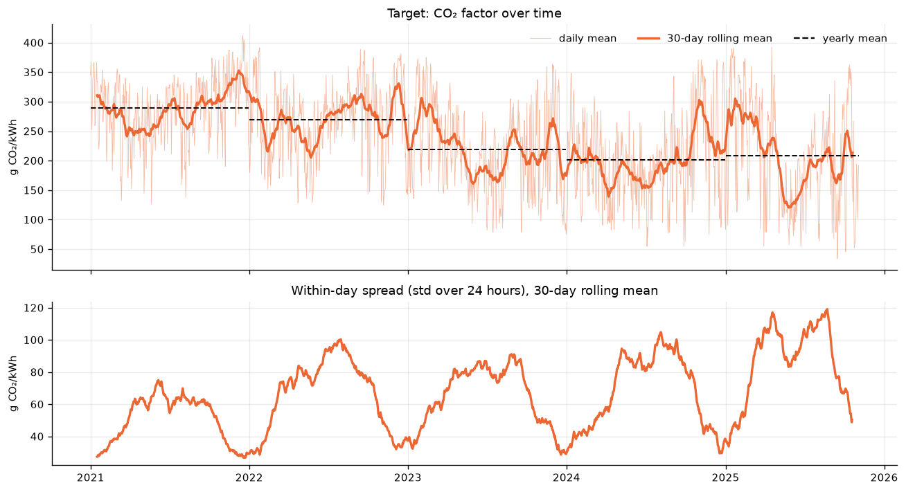

An STL decomposition of monthly means separates a downward trend that levels off from 2024, a yearly cycle with a winter high and a summer low whose amplitude grows every year, and a residual that widens over the years as the renewable share grows.

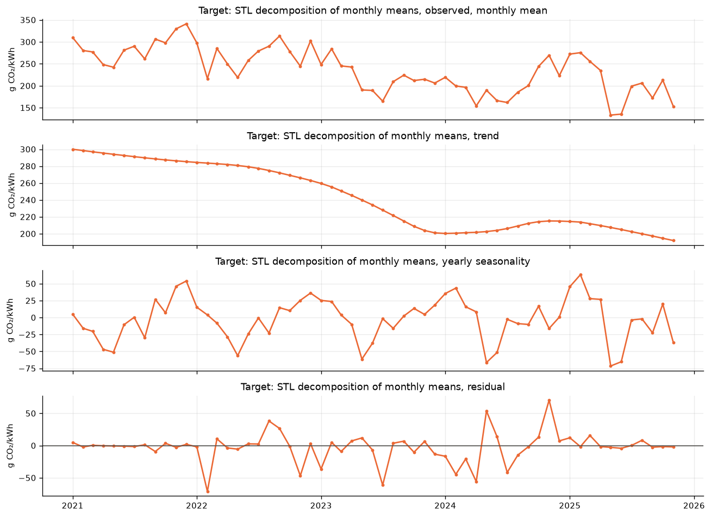

The distribution became two-humped. In 2021 there was one peak near 350. By 2025 a second peak near zero appeared, formed by summer midday hours with surplus solar. Errors in g/kWh are therefore hard to compare across years.

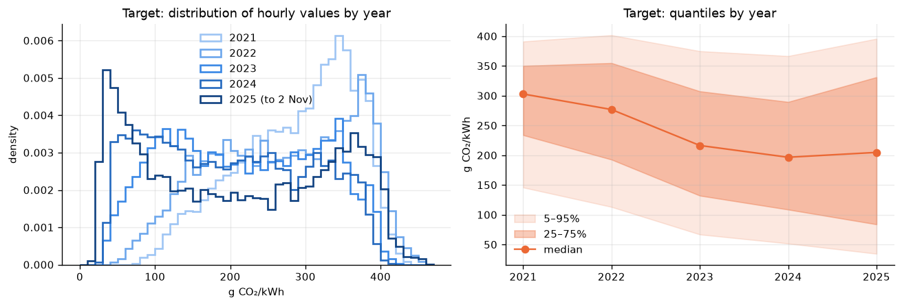

The daily and seasonal rhythm is strong. The minimum is at noon from April to September, and the summer midday dip deepens year over year while the night level changes less. In winter solar hardly matters and wind decides.

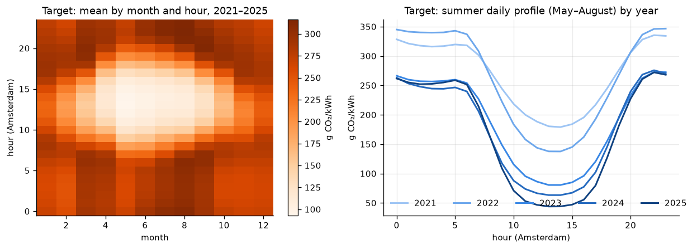

CO₂ against the renewable share is a straight line, and this follows from how NED computes the factor: emissions divided by total production, with solar and wind contributing zero emissions. Against renewable MW the relation is curved and flattens near zero. Total production on its own tells little.

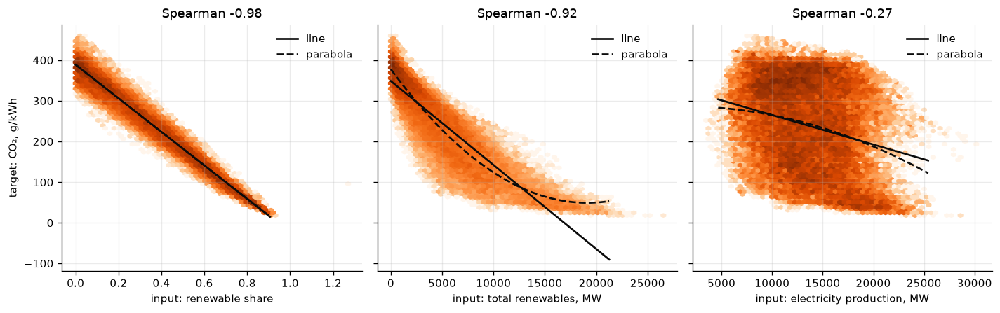

The autocorrelation of the CO₂ factor is dominated by the daily cycle. Once that cycle is removed, the correlation with the past fades within 3–4 days, well short of the 7-day horizon. Recent CO₂ values are therefore useful for the first 1–2 days of the forecast and the rest has to come from the inputs.

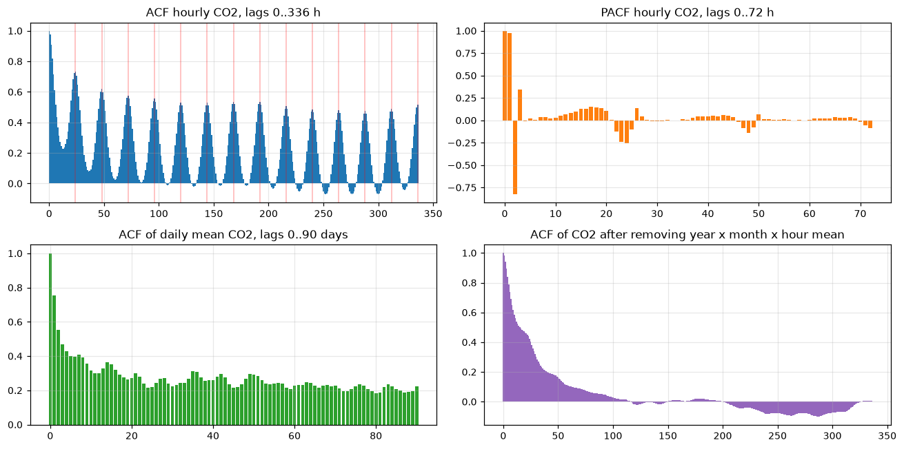

Cross-correlation with lags from −48 to +48 h shows that solar, wind and the renewable share are tied to CO₂ in the same hour, with no lead or lag to exploit, so the forecast rests on the forecasted inputs for that same hour. Onshore wind correlates with CO₂ one hour later about as strongly as in the same hour, which is consistent in every year; the series timestamp appears shifted by about an hour, so the model takes onshore wind at t and t+1.

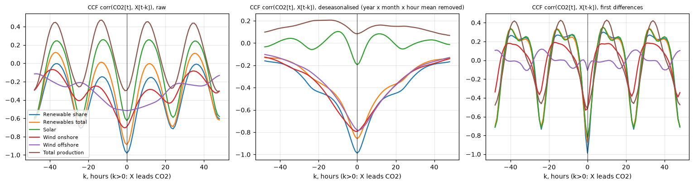

Three facts were confirmed by tests at the 0.05 threshold on daily and monthly aggregates: the level of the factor drifts from year to year, weekends are lower than weekdays while holidays make no difference, and the relation to the renewable share is linear.

For modeling this means predicting through the renewable share, with a linear model on share and a nonlinear one on MW. The level drifts year to year, so the model needs a recent training window, normalised inputs and a correction from its latest errors. CO₂ history is worth using only for the first days of the week; after that quality is set by the weather forecast. Of the calendar features, hour, month and weekday matter and holidays add nothing.

## 3. Forecast setup and metric

A forecast is issued once a day at 06:00 UTC and covers the next 168 hours. When a forecast is issued, the model has every series up to the previous hour and the calendar of the coming week. The data is split by time:

| Period | Use |
|---|---|
| 2021-01-01 – 2025-06-23 | training for the validation period |
| 2025-07-01 – 2025-12-31 | validation: one continuous period, forecast by models trained on everything before it with a 7-day gap; model hyperparameters are chosen here |
| 2026-01-01 – 2026-10-26 | holdout for all models, 299 daily forecasts in 5 two-month folds, models refitted before each fold on everything before it with a 7-day gap; used once, for the numbers in this report |

The error metric is the mean absolute error (MAE) in g CO₂/kWh over all hours of all forecasts in a period, and the same error per forecast day. It is in the units of the target and it is robust to the heavy tails of the two-humped distribution. Next to it I report the relative improvement in MAE over a naive forecast, per forecast day. The naive forecast is the average hourly profile of the last 28 days: among the history-only forecasts it has the lowest error, and its error is the same on every day of the horizon, so it is a stable reference for how much a model adds on each day. RMSE, R² and the rank correlation within the week are in the appendix.

## 4. Baselines

The baselines use the CO₂ factor, the three renewable series and the calendar, nothing forecasted.

| Baseline | How it forecasts |
|---|---|
| last value | repeats the last hour for all 168 hours |
| same hour yesterday / same hour last week | copies the day or the week before |
| 28-day hourly profile | mean of the same hour over the last 28 days; the naive reference |
| ridge regression on lags | one ridge regression per horizon hour; inputs: how far CO₂ and renewables stood from their profiles at the last hour, last day and last week, plus weekday and month |
| LightGBM on lags | one model for all horizons, same inputs plus the horizon |
| exponential smoothing | daily season, refitted every day on the last 28 days |
| SARIMAX | daily season, exogenous weekend flag and renewables (past actual, future from the profile), refitted on the last 28 days |

The two lag models predict the deviation of CO₂ from the 28-day profile rather than CO₂ itself, so the level drift between years drops out.

<table><tr><td width="50%">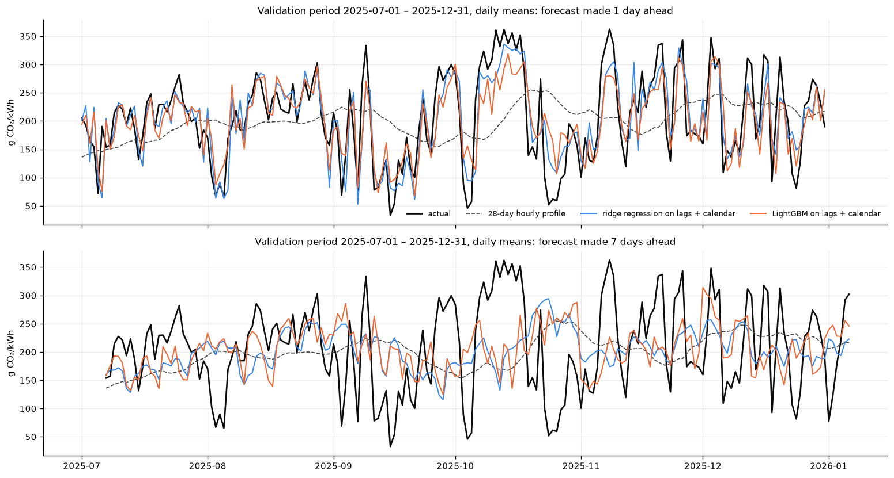</td><td width="50%">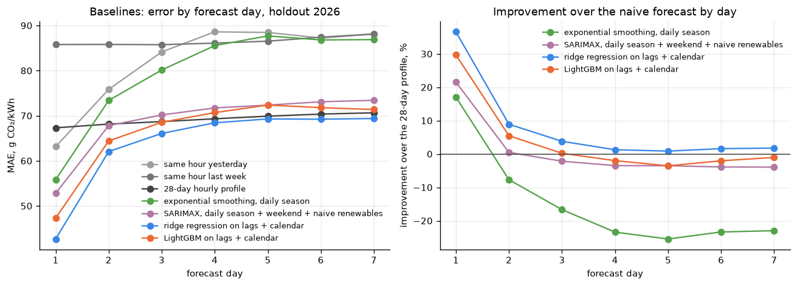</td></tr></table>

On day 1 the ridge regression on lags is a third better than the profile, on day 2 a few percent, and from day 3 on every model sits on the profile. SARIMAX and exponential smoothing follow the same curve from a worse start. The validation plot shows why: one day ahead the models track the current level, seven days ahead they have decayed to the profile and miss every swing that the wind brings.

So history carries the forecast for one day, and the rest of the week is decided by the weather. This splits the problem in two, and the following sections build two separate models: one for the near horizon, driven by recent history, and one for the far horizon, driven by weather forecasts of renewable production.

## 5. Additional data and pretrained forecasters

The modeling task became three forecasts of renewable production, solar, onshore wind and offshore wind, feeding two CO₂ models. Along the way the project gained new datasets: GEFS and ECMWF weather forecasts, ENTSO-E day-ahead forecasts, generation by fuel type and outage announcements, and NED production by fuel type. Details follow with the models that use them.

Before building those models I ran two pretrained forecasters on the CO₂ factor as a reference, both zero-shot with the longest context they accept. Chronos-2 gets the CO₂ history, the measured series as past covariates and the calendar. TimesFM-3 gets everything known at forecast time: the same history and calendar, and the renewables and weather forecasts of the following sections as known covariates, so it is the strongest reference the CO₂ models of section 8 have to beat. Validation is 2025-07-01 – 2025-12-31, one forecast a day at 06 UTC; the ridge regression on lags from the baselines is rerun on the same days.

<table><tr><td width="50%">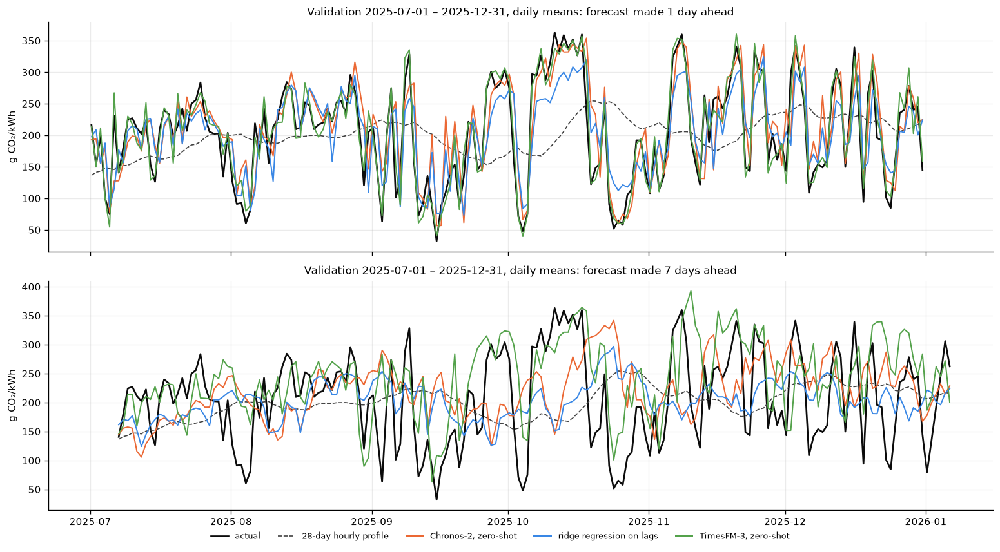</td><td width="50%">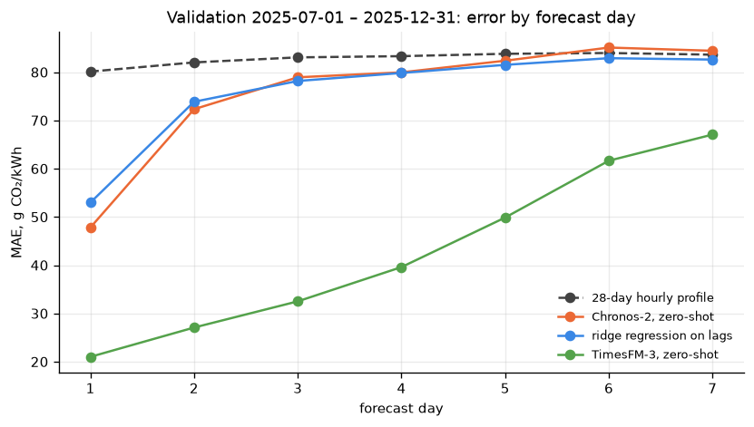</td></tr></table>

Chronos-2 behaves like the ridge regression: a clear gain on the first day, a smaller one on the second, and the profile from day 3 on. TimesFM-3 with the forecasted inputs halves the profile's error and keeps a margin on every day of the week (Appendix B).

## 6. Forecasting renewable production

The three renewable series are forecast separately, each for the 168 hours after the daily 06 UTC forecast time, in kWh per hour as NED publishes them. The reference for every later model is the same as for CO₂: the 28-day hourly profile, the same hour of yesterday, and Chronos-2 and TimesFM-3 run zero-shot, here with the GEFS and ECMWF weather forecasts as covariates known for the whole window. All are scored on the 365 daily forecasts of 2025, the test period of the renewables models.

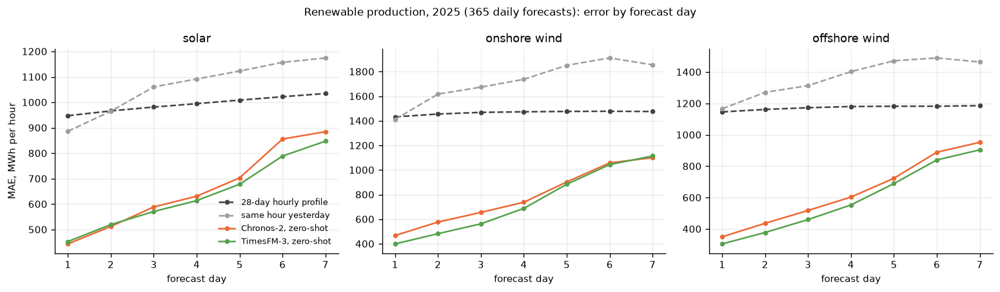

The weather-driven forecasts are two to three times more accurate than anything built from the series alone, and their error grows with the lead of the weather forecast. One more thing was settled here: separate models for days 1–2 and days 3–7, as planned for CO₂, bring nothing for renewable production, the error on the 2024 folds is the same to within a fraction of a percent, so each renewable series is forecast for all seven days by a single model.

## 7. Models for renewable production

Each of the three series gets one LightGBM model that forecasts all 168 hours; a row of its training table is one forecast hour of one day. The model does not predict kWh directly but a ratio to a scale that is known at forecast time, so that the growth of installed capacity drops out of the target and the model sees the same range of values in every year.

Solar: the target is production divided by clear-sky irradiance, so the model predicts how much of a clear-sky day is realised. Inputs: the forecast clearness index from GEFS (ensemble mean and spread) and ECMWF (mean and spread), the forecast hour, clear-sky irradiance, the recent clear-sky production level over the last 28 days and the last day, and yesterday's GEFS error. Night hours are forecast as zero.

Wind: the target is production as a fraction of recent capacity (the 99th percentile of the last 60 days). Inputs: the forecast wind speed at 100 m over the wind-farm locations from GEFS (ensemble mean and spread) and ECMWF (mean and spread), the forecast hour, the production of the last hour and the last day, and yesterday's error of a simple power curve on GEFS. Onshore production is the NED series, offshore the metered series from the grid operator.

Hyperparameters are chosen by Optuna in 20 trials on the six two-month folds of 2024; the chosen configuration is refitted before each monthly fold of 2025, and the 2025 forecasts are scored against the baselines of section 6.

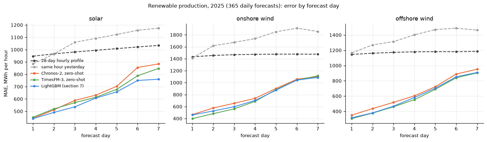

| Series | LightGBM MAE | improvement over profile, % | TimesFM-3 MAE | improvement, % |
| --- | --- | --- | --- | --- |
| solar | 606 | 39 | 639 | 36 |
| onshore wind | 756 | 48 | 739 | 50 |
| offshore wind | 602 | 49 | 590 | 50 |

MAE in MWh per hour, 365 daily forecasts of 2025; the full table is in Appendix C. Each model has a card in the repository with its features, search ranges, chosen configuration and feature importance.

LightGBM is the best model on solar on every day of the horizon and matches TimesFM-3 on wind: ahead on days 6–7 onshore, level offshore, and a little behind on the first days, where TimesFM-3 profits from its long context. All three models cut the profile's error roughly in half for wind and by a third to two fifths for solar. The wind models under-forecast the hours of highest production.

## 8. Forecasting the CO₂ factor

Each method has two models: hours 0–47 predict the change of the factor from the last known hour, hours 48–167 predict the deviation from the 28-day profile. The inputs are the renewables forecasts of section 7 (out of sample), the last known values of the measured series, the calendar, the weather forecasts, the day-ahead values for the first day and the announced outages.

Three methods are compared: LightGBM, with hyperparameters from an Optuna search on the monthly folds of 2025; an MLP on the same table; and an LSTM that encodes the last 336 hours and decodes the 168 forecast hours. The networks use starting hyperparameters and are averaged over several seeds. TimesFM-3 with the same inputs is the external reference. Validation is 2025-07-01 – 2025-12-31 (184 forecasts), the holdout is 2026-01-01 – 2026-10-26 (299 forecasts), scored once with the models refitted every two months.

<table><tr><td width="50%">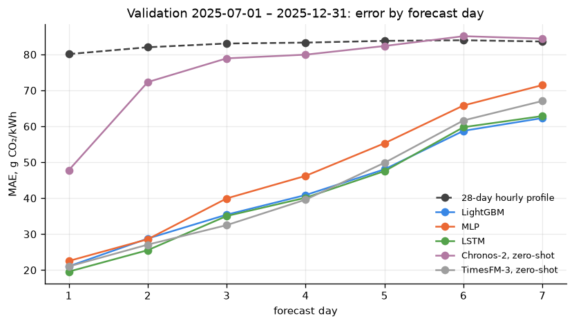</td><td width="50%">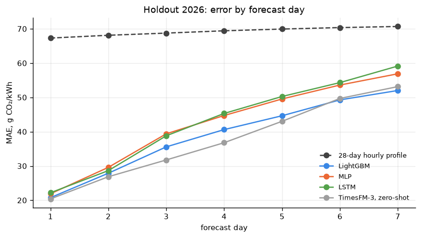</td></tr></table>

| Model | validation MAE | improvement, % | holdout MAE | improvement, % |
|---|---|---|---|---|
| TimesFM-3, zero-shot | 42.7 | 48 | 37.4 | 46 |
| LightGBM | 42.2 | 49 | 38.7 | 44 |
| LSTM | 41.5 | 50 | 42.7 | 38 |
| MLP | 47.1 | 43 | 42.2 | 39 |
| Chronos-2, zero-shot | 75.9 | 8 | – | – |
| 28-day hourly profile | 82.9 | 0 | 69.2 | 0 |

MAE in g CO₂/kWh; improvement relative to the 28-day profile. Full table in Appendix D.

On validation the LSTM, LightGBM and TimesFM-3 are equal at half the profile's error. On the holdout TimesFM-3 and LightGBM keep that level, while the two networks lose about 4 g/kWh, with the gap opening from day 3. The gain over the profile is three quarters on day 1 and a quarter on day 7: with forecasted renewables as inputs the models stay ahead over the whole week, where the history-only forecasts of sections 4–5 had reached the profile by day 3.

<table><tr><td width="50%">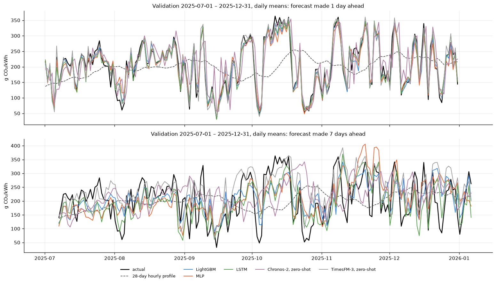</td><td width="50%">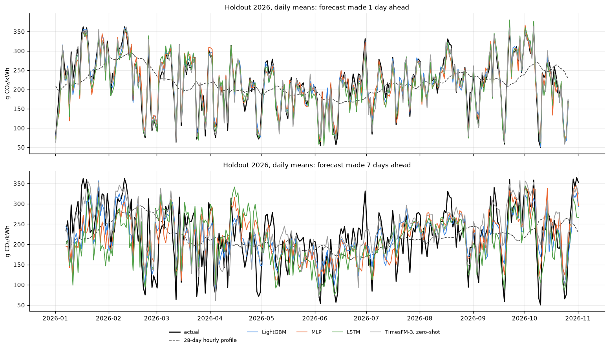</td></tr></table>

The LSTM's weaker holdout comes from overfitting on the far horizon. On hours 0–47 the loss on the held-out fold flattens after a few epochs; on hours 48–167 it is lowest around epoch 4 and then rises by a third while the training loss keeps falling. These curves come from the first 2026 fold, so they diagnose the problem but cannot be used to pick the number of epochs; that choice belongs to the 2025 validation, and the model keeps its 20 epochs here.

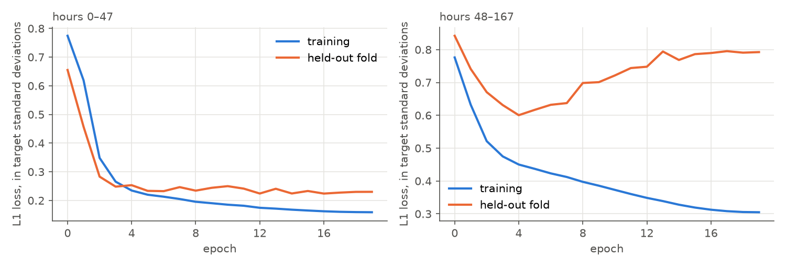

The result: a LightGBM model on forecasted renewable production, tuned on 2025, halves the error of the naive forecast on unseen 2026 data and matches a large pretrained forecaster given the same inputs. The neural networks reach the same accuracy on validation but need tuning to hold it.

## 9. Possible improvements

- Predictors for the non-renewable side: gas, coal, combined heat and power and imports, forecast from prices, outages and demand the way renewables are forecast from weather, so that the CO₂ model gets both sides of the mix as inputs.
- Epochs and regularisation for the networks chosen on the 2025 validation, where the far-horizon LSTM overfits.
- Weighting of the two weather sources: ECMWF is the more accurate forecast, GEFS covers the whole training period; a per-lead combination instead of using both as separate inputs.
- An ensemble of LightGBM and TimesFM-3, which make different errors on the far days.
- Prediction intervals from the GEFS ensemble spread instead of a single value per hour.

## Appendix

### A. Baselines on the holdout

299 forecasts, 2026-01-01 – 2026-10-26, models refitted every two months. Improvement is the relative reduction in MAE against the 28-day hourly profile. Spearman is the rank correlation between forecast and actual within each 168-hour window, averaged over windows.

| Model | MAE | RMSE | Spearman | improvement, % |
|---|---|---|---|---|
| last value | 131.6 | 166.3 | 0.00 | -90.2 |
| same hour yesterday | 82.2 | 110.8 | 0.58 | -18.8 |
| same hour last week | 86.5 | 115.3 | 0.50 | -25.0 |
| 28-day hourly profile | 69.2 | 88.5 | 0.64 | 0.0 |
| ridge regression on lags + calendar | 63.9 | 82.8 | 0.69 | 7.7 |
| LightGBM on lags + calendar | 66.6 | 85.7 | 0.68 | 3.7 |
| exponential smoothing, daily season | 79.5 | 102.6 | 0.62 | -14.8 |
| SARIMAX, daily season + weekend + naive renewables | 68.8 | 87.1 | 0.67 | 0.6 |

### B. Pretrained forecasters on the validation period

184 daily forecasts, 2025-07-01 – 2025-12-31, issued at 06 UTC, zero-shot, context 8192 h. Chronos-2: CO₂ history, measured series as past covariates, calendar. TimesFM-3: the same plus the renewables, weather and outage forecasts as known covariates.

| Model | MAE | RMSE | improvement, % | Spearman |
|---|---|---|---|---|
| TimesFM-3, zero-shot | 42.7 | 61.4 | 48.5 | 0.83 |
| Chronos-2, zero-shot | 75.9 | 99.0 | 8.4 | 0.58 |
| ridge regression on lags | 76.0 | 94.7 | 8.3 | 0.56 |
| 28-day hourly profile | 82.9 | 101.9 | 0.0 | 0.52 |

### C. Renewable production, 2025

365 daily forecasts, 2025-01-01 – 2025-12-31, issued at 06 UTC. MAE in MWh per hour; improvement is relative to the 28-day hourly profile.

| Target | Model | MAE | improvement, % |
|---|---|---|---|
| solar | 28-day hourly profile | 994 | 0.0 |
| solar | same hour yesterday | 1065 | -7.2 |
| solar | Chronos-2, zero-shot | 660 | 33.6 |
| solar | TimesFM-3, zero-shot | 639 | 35.7 |
| solar | LightGBM | 606 | 39.0 |
| onshore wind | 28-day hourly profile | 1465 | 0.0 |
| onshore wind | same hour yesterday | 1722 | -17.5 |
| onshore wind | Chronos-2, zero-shot | 785 | 46.4 |
| onshore wind | TimesFM-3, zero-shot | 739 | 49.6 |
| onshore wind | LightGBM | 756 | 48.4 |
| offshore wind | 28-day hourly profile | 1173 | 0.0 |
| offshore wind | same hour yesterday | 1368 | -16.7 |
| offshore wind | Chronos-2, zero-shot | 639 | 45.5 |
| offshore wind | TimesFM-3, zero-shot | 590 | 49.7 |
| offshore wind | LightGBM | 602 | 48.7 |

### D. CO₂ models: validation and holdout

Validation 2025-07-01 – 2025-12-31 (184 daily forecasts), holdout 2026-01-01 – 2026-10-26 (299). Improvement is relative to the 28-day hourly profile.

| Period | Model | MAE | RMSE | improvement, % | Spearman |
|---|---|---|---|---|---|
| validation | 28-day hourly profile | 82.9 | 101.9 | 0.0 | 0.52 |
| validation | LightGBM | 42.2 | 58.2 | 49.1 | 0.83 |
| validation | MLP | 47.1 | 64.4 | 43.1 | 0.79 |
| validation | LSTM | 41.5 | 58.2 | 49.9 | 0.83 |
| validation | Chronos-2, zero-shot | 75.9 | 99.0 | 8.4 | 0.58 |
| validation | TimesFM-3, zero-shot | 42.7 | 61.4 | 48.5 | 0.83 |
| holdout | 28-day hourly profile | 69.2 | 88.5 | 0.0 | 0.64 |
| holdout | LightGBM | 38.7 | 53.6 | 44.1 | 0.87 |
| holdout | MLP | 42.2 | 57.7 | 39.0 | 0.85 |
| holdout | LSTM | 42.7 | 59.6 | 38.4 | 0.85 |
| holdout | TimesFM-3, zero-shot | 37.4 | 52.9 | 46.0 | 0.87 |
